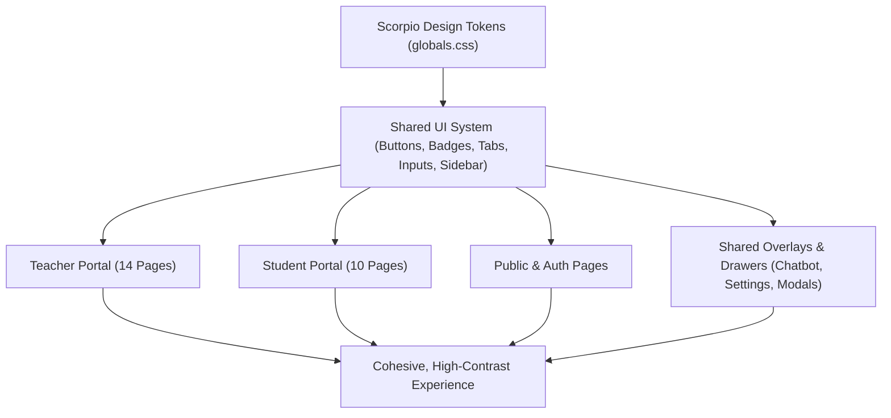

# Full-Stack UI Audit & Cohesion Plan: Scorpio Theme & Page-by-Page Polish

## Goal Description
Following the successful calibration of Scorpio's design tokens (electric royal blue `--primary: oklch(0.6203 0.1952 253.7510)` with pure white text, neutral zinc surfaces, crisp hairlines, and focused white typography), this plan establishes an exhaustive, page-by-page audit and cleanup across the entire application.

The goal is to eliminate remaining legacy styling anti-patterns (such as hardcoded `dark:text-black`, `bg-zinc-900 dark:bg-white` button overrides, mismatched dropdown hover states, and chromatic input borders) and ensure that every screen across the Teacher Portal, Student Portal, Public/Auth pages, and Shared Overlays feels cohesive, high-contrast, and distraction-free in both dark and light modes.



---

## User Review Required

> [!IMPORTANT]
> **Audit Scope & Grouping Strategy**:
> Rather than modifying dozens of pages at once in an uncontrollable blast, we will execute the audit in **4 logical phases**:
> 1. **Phase 1: Global Overlays & Core Controls [COMPLETED]** (Support drawer submit button, `DropdownMenu`, active `TabsTrigger`, and button hover standards).
> 2. **Phase 2: Teacher Portal Pages [COMPLETED]** (Dashboard, Network & Billing, Waypoints template fork, Vault add-formula CTA, Grades, Assignments, Students).
> 3. **Phase 3: Student Portal Pages [COMPLETED]** (Dashboard, Assignments, Assignment View, Submissions, Grades, Resources, Practice, Equation Vault, Notebook, and Raise).
> 4. **Phase 4: Public, Marketing & Auth Pages [COMPLETED]** (Landing, Features, Pricing tier cards, Login, Signup).

> [!NOTE]
> **Button Consistency Rule**:
> All primary actions across the platform will strictly use the electric blue background with pure white text (`bg-primary text-primary-foreground hover:bg-primary/90`), while outline buttons will strictly use subtle neutral borders and hover backgrounds (`hover:bg-accent hover:text-accent-foreground`). Hardcoded black/white button overrides (`dark:bg-white dark:text-black`) will be replaced.

---

## Proposed Changes

### Phase 1: Shared Overlays & Global Controls [COMPLETED]

Standardized dropdown menu hover states, tabs active styling, tooltips, dialog/sheet close controls, and both chatbot overlays (Support Drawer & Landing Chatbot).

#### [COMPLETED] `src/components/navigation-chatbot.tsx`
- Replaced hardcoded `bg-black text-white dark:bg-white dark:text-black` on the Support Form submit button ([Line 475](file:///Users/rushilmahadevu/source/typescript/scorpio/src/components/navigation-chatbot.tsx#L475)) with standard `Button` tokens (`bg-primary text-primary-foreground hover:bg-primary/90`).
- Updated the quick action navigation pills inside the chatbot to use `border-border/60 hover:border-primary/40 hover:bg-primary/5 text-muted-foreground hover:text-foreground`.
- Standardized active issue type selector pills, chat input send button, assistant avatar, and user message bubbles to use Scorpio electric blue tokens.

```diff
- className={cn(
-   "h-9 px-4 rounded-lg text-xs font-bold cursor-pointer",
-   "bg-black text-white hover:bg-black/85 dark:bg-white dark:text-black dark:hover:bg-white/85"
- )}
+ className="h-9 px-4 rounded-lg text-xs font-bold cursor-pointer bg-primary text-primary-foreground hover:bg-primary/90"
```

#### [COMPLETED] `src/components/landing-chatbot.tsx`
- Standardized assistant avatar and send button with `bg-primary text-primary-foreground hover:bg-primary/90`.
- Replaced legacy zinc hardcoded colors on user message bubbles and close controls with standard semantic tokens (`bg-primary text-primary-foreground`, `hover:bg-muted text-muted-foreground hover:text-foreground`).

#### [COMPLETED] `src/components/ui/tabs.tsx`
- Standardized `TabsTrigger` active state across light and dark modes, removing muted dark mode overrides (`dark:bg-input/30`) and ensuring crisp high contrast (`data-[state=active]:bg-background data-[state=active]:text-foreground data-[state=active]:shadow-xs`) with `cursor-pointer`.

#### [COMPLETED] `src/components/ui/dropdown-menu.tsx` & `src/components/ui/select.tsx`
- Added `cursor-pointer` to `DropdownMenuItem`, `DropdownMenuCheckboxItem`, `DropdownMenuRadioItem`, `DropdownMenuSubTrigger`, and `SelectItem`.

#### [COMPLETED] `src/components/ui/button.tsx`, `src/components/ui/tooltip.tsx`, `src/components/ui/dialog.tsx`, `src/components/ui/sheet.tsx`
- Standardized outline button variant to use subtle neutral borders and hover backgrounds (`border border-border bg-background hover:bg-accent hover:text-accent-foreground`).
- Refined tooltip offset (`sideOffset = 4`), shadow, and contrast.
- Ensured dialog and sheet close buttons carry `cursor-pointer`.

---

### Phase 2: Teacher Portal Cleanup [COMPLETED]

- **Dashboard** uses the shared blue primary button for Create Assignment and Create Class, with neutral outline buttons for the other shortcuts.
- **Network and Billing** use the shared primary style for invitations, copying an invite link, saving quota settings, and starting checkout. Quick-add quota buttons and billing cycle options use neutral hover states.
- **Waypoints** uses the shared primary button for Acquire Template and theme tokens for cards, filters, and tabs.
- **Vault** uses the shared primary button for Add Formula and semantic colors for the filters, formula previews, and save bar. The management guide can receive keyboard focus.
- **Assignments, Grades, and Students** use shared styles for creation, roster import, and secondary row actions. Navigation controls render as links and icon-only actions have accessible names.

Verified with TypeScript, the production build, and 22 unit tests. Chromium with seeded Firebase emulators exercised class creation, invite copying, quota steppers and saves, Waypoints acquisition, Vault formula saves, roster dialog access, and billing option changes in light and dark mode.

Phase 2 uses the existing theme palette. The default dark-mode blue has approximately 3.7:1 contrast with white text.

The teacher layout follow-up brings the grading queue and classes to the top of the Dashboard. The Gradebook uses one table with a distribution that opens on demand. Assignments, Students, Resource Uploads, and both submission history pages use simpler tables and fewer competing actions.

---

### Phase 3: Student Portal Cleanup [COMPLETED]

The student pages use the header and summary patterns from the [teacher style guide](docs/teacher-ui-style.md). Filters sit next to results, supporting controls open when needed, and primary actions use the shared blue button.

| Screen | Layout and theme changes |
| --- | --- |
| Dashboard | Puts class enrollment first, condenses coursework counts into one summary, and groups study shortcuts. The setup guide opens on demand. |
| Assignments | Uses a single list with due date and status next to each title. Status and sort menus use neutral hover and focus styles. |
| Assignment View | Reduces the timed-start screen to instructions and a single action. Calculator and Raise hand use shared toggle styles, with space for the timer at phone widths. |
| My Submissions | Uses a compact history table with the submitted date under each assignment and a shortcut to grades. |
| Grades | Puts score totals in one strip and keeps per-question answers and feedback in a details dialog. |
| Resources | Shows search and type filters above one list of teacher links. |
| Practice | Shows the generation pause and keeps recent attempts and accuracy visible. Removes the unreachable practice setup and session UI. |
| Equation Vault | Combines search, category, and layout controls. Adds labeled copy buttons and puts constants behind a disclosure. |
| Notebook | Gives the editor more room, groups preview and save controls, and opens Raise help on demand. |
| Raise | Opens on the conversation with history available on demand. Keeps the mode switch in one place and leaves the composer focused on the message. |

Verified with a production build, 22 unit tests, and a seeded Chromium run against local Auth and Firestore emulators. All ten student routes rendered at desktop width in light mode and at 390 px in dark mode. The browser run saved and submitted an assignment, opened grade feedback, filtered resources, read Practice history, copied an equation, saved and previewed a note, and exercised Raise history and mode controls.

### Phase 4: Public & Auth Pages Cleanup [COMPLETED]

| Screen | Layout and theme changes |
| --- | --- |
| Landing, Features, Demos, and Sustainability | Share marketing navigation and the theme toggle. Primary and outline links use the shared button variants. Feature screenshot previews open from keyboard-accessible controls. Missing carousel clips link to the full demo. |
| Pricing | Uses blue for Annual, the featured tier, and outline for Free, Monthly, and Contact Sales. The comparison fits narrow screens and the cards use theme surfaces. |
| Login, Signup, and Forgot Password | Use blue submit buttons, shared input borders and focus rings, and a common back link and theme toggle. Password visibility buttons have accessible names. The current forms use email and password. |
| Request Access and Network Invite | Use shared form and button styles, with room for the access form header at phone widths. |
| About, Research, Contact, Privacy, and Terms | Share a neutral documentation sidebar, a theme toggle, and a mobile menu that closes after navigation. |
| Raise preview and page fallback | Use blue for the Send and Back Home actions and neutral styles for secondary controls. |

Chromium checked the public screens at 1440 px in light mode and at 390 px in dark mode. It exercised plan actions, theme switching, the docs drawer, password visibility, and the full-demo link for unavailable clips. Request Access and Raise used stubbed API responses. The network invite check covered its initial loading state. The dark-mode primary color uses the palette described in Phase 2.

---

## Verification Plan

### Automated Tests
1. **TypeScript Type Safety**:
   ```bash
   npx tsc --noEmit
   ```
2. **Next.js Production Build**:
   ```bash
   npm run build
   ```

### Manual Verification
1. **Teacher Portal Workflow**:
   - Navigate to `/teacher` (Dashboard): Verify metrics cards, quick actions, "Create Class" button (blue + white text), and assignment links.
   - Navigate to `/teacher/network`: Verify "Invite Colleague", copy link button, and dark metrics strip.
   - Navigate to `/teacher/waypoints`: Verify the "Acquire Template" button is electric blue with white text.
   - Navigate to `/teacher/vault`: Verify the "Add Formula" button is electric blue with white text.
2. **Student Portal Workflow**:
   - Check all ten student routes in light and dark mode at desktop and phone widths.
   - Filter and sort assignments, open the calculator and Raise hand controls, and save and submit a response.
   - Find the submission in history and open graded feedback from Grades.
   - Filter resources, review Practice history, and filter and copy equations from the Vault.
   - Save, preview, and open a note in Focus view. Open Raise help in Notebook and check conversation history and mode controls in Raise.
3. **Public & Theme Toggle**:
   - Check the public routes in light and dark mode at desktop and phone widths.
   - Verify the pricing tiers, auth tabs and password visibility, shared navigation, docs drawer, and the Raise and Request Access form states.
